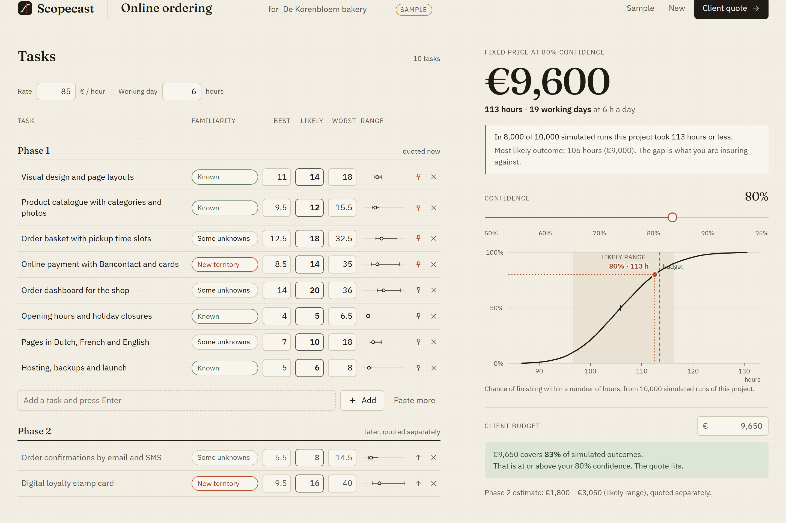

# Scopecast

**Quote fixed-price software work with a stated confidence level.**

Freelancers quote a single number per task, add "+20%", and absorb the overrun when a task blows up.
Scopecast asks for a *range* per task (best / likely / worst hours), simulates the project 10,000 times,
and gives you the price and delivery date that cover the share of outcomes you choose — "80% of simulated
runs finish within 99 hours, so the fixed price is €8,400". When the client's budget is lower, it tells you
which tasks to move to a **phase 2** so the quote still holds, instead of quietly shaving hours.

Built for [Build With AI: Basics](https://learn-ai-basics.devpost.com/) with the Devpost Learn Skill Pack.
The planning documents the skills produced are in [`devpost/`](devpost/): [scope](devpost/scope.md),
[PRD](devpost/prd.md), [spec](devpost/spec.md) and the [build checklist](devpost/checklist.md).



## Try it

Requirements: Node.js 22+ and npm. No accounts, API keys or environment variables.

```bash
npm install
npm run dev        # open http://localhost:5173 and click "try the sample project"
npm test           # unit tests for the parser, simulator, budget fitter and persistence
npm run build      # static build in dist/
```

Everything runs in the browser; the project is saved in this browser's local storage and nothing is sent
anywhere.

## How it works

| Piece | File | What it does |
|---|---|---|
| Parser | `src/engine/parse.ts` | One task per pasted line; strips bullets and numbering; de-duplicates |
| Estimates | `src/engine/estimate.ts` | Familiarity presets (Known 0.8×/1.3×, Some unknowns 0.7×/1.8×, New territory 0.6×/2.5×); sorts and flags out-of-order ranges |
| Simulator | `src/engine/simulate.ts` | Seeded PERT (beta) sampling per task, 10,000 runs, percentiles and coverage |
| Budget fitter | `src/engine/fit.ts` | Best-first search over the optional tasks, in order of expected hours removed, checked against the real simulated runs; pinned must-haves are never deferred |
| UI | `src/components/` | Workbench, SVG forecast curve, confidence dial, printable client quote |

The price is the hours at the chosen percentile × your hourly rate, rounded up to the next €50.
Each task has its own fixed random seed, so the same inputs always give the same quote, and removing a task
removes exactly its share from every simulated run.

**Limits, stated plainly:** tasks are simulated as independent, so a risk that hits several tasks at once
(a client who is slow to give feedback on everything) is under-represented; the ranges are only as honest as
the person typing them.

## Verification

- `npm test` — 28 unit tests, including a check that the 80th percentile at 10,000 runs varies by less than
  1% across seeds, and a comparison of the budget fitter against every possible subset.
- `python scripts/e2e_check.py http://127.0.0.1:5173/` — walks the whole journey in a headless Chromium
  (paste → hours → familiarity → confidence → budget → phase 2 → reload → quote → one-page PDF → 390 px
  layout) and saves the screenshots in `design/screenshots/`. Needs `pip install playwright` and
  `playwright install chromium`.

## Credits

- Fonts: [Fraunces](https://fonts.google.com/specimen/Fraunces) and
  [IBM Plex Sans](https://fonts.google.com/specimen/IBM+Plex+Sans), SIL Open Font License 1.1, via Fontsource.
- Design system: [`design/STYLE_GUIDE.md`](design/STYLE_GUIDE.md). Generated marketing images are listed in
  [`design/GENERATED_ASSETS.md`](design/GENERATED_ASSETS.md); none are used inside the app.
- The sample bakery ("De Korenbloem") is fictional.

## Licence

[MIT](LICENSE) © 2026 Rui Codex
